# Spring Boot Kotlin Monitoring

[](https://github.com/hendisantika/spring-boot-kotlin-monitoring/actions/workflows/gradle.yml)


An example Spring Boot 4 MVC application written in Kotlin that wires **logs + traces + metrics** together, using
Grafana as the single source of truth so you can jump from any signal to the others and track down problems in your
system.

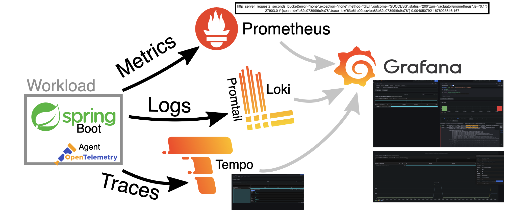

- **Grafana Loki**: ingests the application's logs through the Logback appender (`logback-spring.xml`).
- **Grafana Tempo**: stores traces (from the Grafana team).
- **Prometheus**: a time series database, one of the best options for storing your app's metrics.
- **Exemplars**: references to data outside of the metric set. A common use case is the ID of a trace.
  - Example metric with a `trace_id`:

    ```
    foo_bucket{le="1"} 11 # {trace_id="KOO5S4vxi0o"} 0.67
    ```

  - Example Spring Boot metric:

    ```
    http_server_requests_seconds_bucket{error="none",exception="none",method="GET",outcome="SUCCESS",status="200",uri="/actuator/prometheus",le="0.1"} 27903.0 # {span_id="b32c07399f9c9a78",trace_id="63e61e02ccc4ea83b32c07399f9c9a78"} 0.004050792 1676025346.167
    ```

## Tech stack

| Component           | Version / Library                                                            |
|---------------------|------------------------------------------------------------------------------|
| JDK                 | 25 (Gradle toolchain)                                                        |
| Kotlin              | 2.4.x                                                                        |
| Spring Boot         | 4.1.x (`webmvc`, `actuator`, `aspectj`, `zipkin`)                            |
| Build               | Gradle 9.3 (wrapper)                                                         |
| Metrics             | Micrometer + `micrometer-registry-prometheus`                                |
| Tracing             | Micrometer Tracing with the Brave bridge, reported to Tempo over Zipkin      |
| Logs                | `kotlin-logging` + `loki-logback-appender`                                   |
| Infrastructure      | Docker Compose: Grafana, Loki, Tempo, Prometheus                             |

## Prerequisites

- JDK 25 (Gradle will provision it through the toolchain if it isn't installed locally)
- Docker with Docker Compose

## Infrastructure: Docker Compose

The project ships a `compose.yml` that starts every container the infrastructure needs.

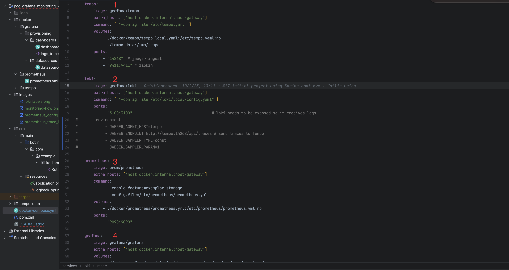

- **Grafana Tempo**: has to be configured with Zipkin as its receiver so it can store the tracing data.

  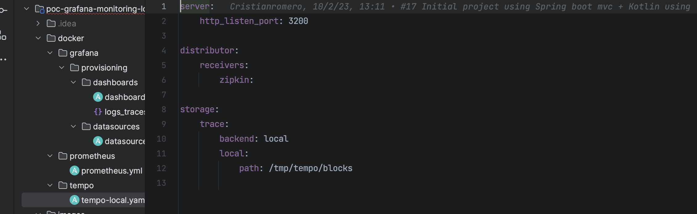

- **Grafana Loki**: stores the logs sent by the Logback appender defined in the application (`logback-spring.xml`).
- **Prometheus**: stores all of the application's metrics exposed by the Spring Boot Actuator endpoint, exemplars
  included.

  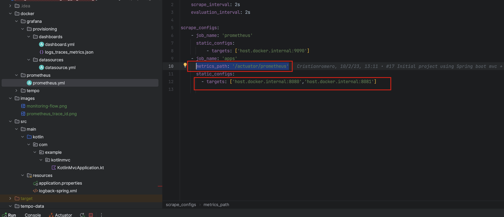

- **Grafana**: shows all metrics, logs and traces on a provisioned dashboard called *Logs, Traces, Metrics*.

  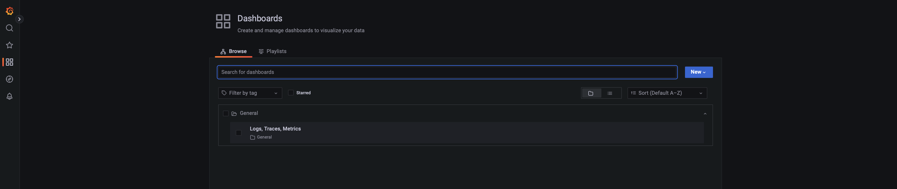

| Service    | URL                                 |
|------------|-------------------------------------|
| App        | http://localhost:8080               |
| Grafana    | http://localhost:3000               |
| Prometheus | http://localhost:9090               |
| Loki       | http://localhost:3100               |
| Tempo      | http://localhost:9411 (Zipkin API)  |

## How it works

Metrics, logs and traces all carry the `trace_id`, so you can navigate from one source to another and find the cause
of an exception in the system.

### Metrics

#### Spring Boot metrics

Spring Boot exposes a metrics endpoint you can use to examine the metrics collected by the application. To correlate
them with a `trace_id`, enable percentile histograms in `application.properties`:

```properties
management.metrics.distribution.percentiles-histogram.http.server.requests=true
```

When you call the Prometheus endpoint (http://localhost:8080/actuator/prometheus) with the
`Accept: application/openmetrics-text; version=1.0.0; charset=utf-8` header, the percentile buckets include the
`trace_id` and `span_id`:

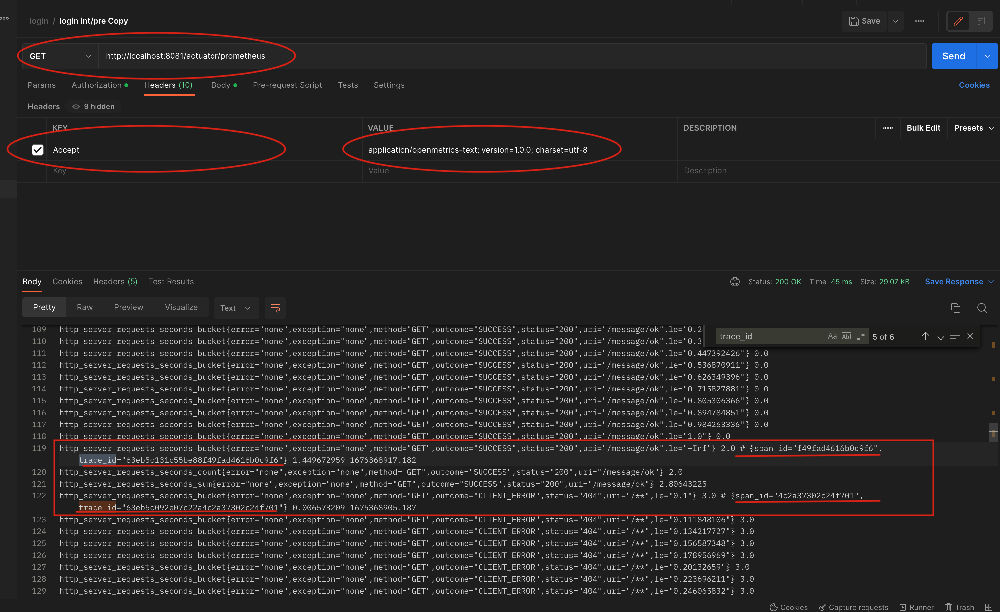

#### Prometheus

Prometheus scrapes the actuator endpoint and stores the exemplars (`trace_id` and `span_id`). See
`docker/prometheus/prometheus.yml`.


### Logging

Grafana Loki stores all of the application's logs. `logback-spring.xml` (in `src/main/resources`) uses the Loki
appender. It is important to define the labels attached to each log line, because they are used later to correlate
logs and traces (the `traceID` label is a must):

```xml
<pattern>app=${appName},host=${HOSTNAME},traceID=%X{traceId:-NONE},level=%level, class=%C</pattern>
```

Generated Loki labels:

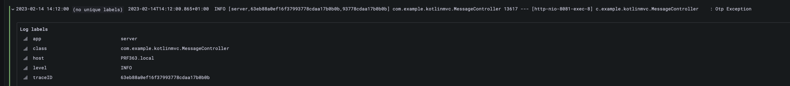

### Tracing

Grafana Tempo stores all of the tracing data (the `traceID` is attached out of the box).

## Grafana configuration in detail

This is the main Grafana configuration that links the `trace_id` across the three layers.

- **Prometheus**: defines how exemplars are used to navigate from metrics to traces.

  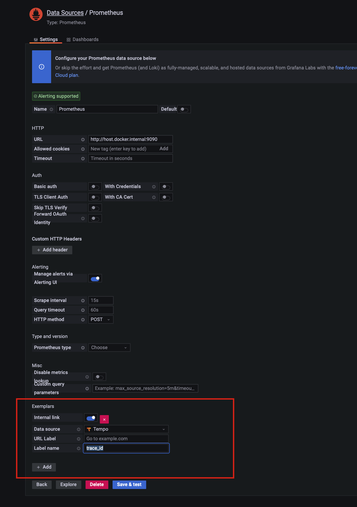
  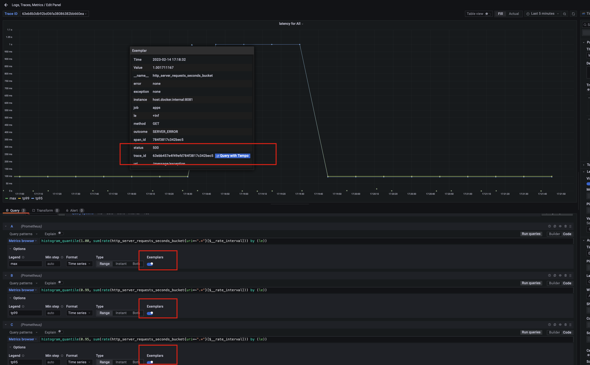

- **Tempo**: defines the Loki query that navigates from a trace to its logs. It correlates `service.name` (tracing
  label) with `app` (the log label defined in the Logback pattern).

  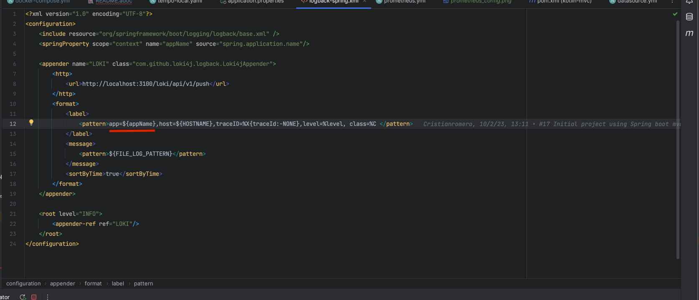
  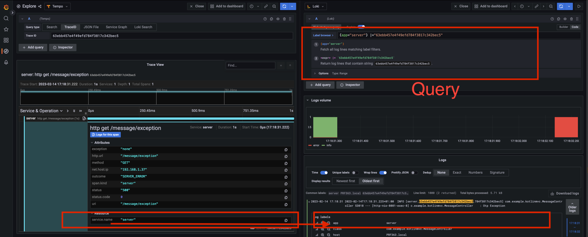
  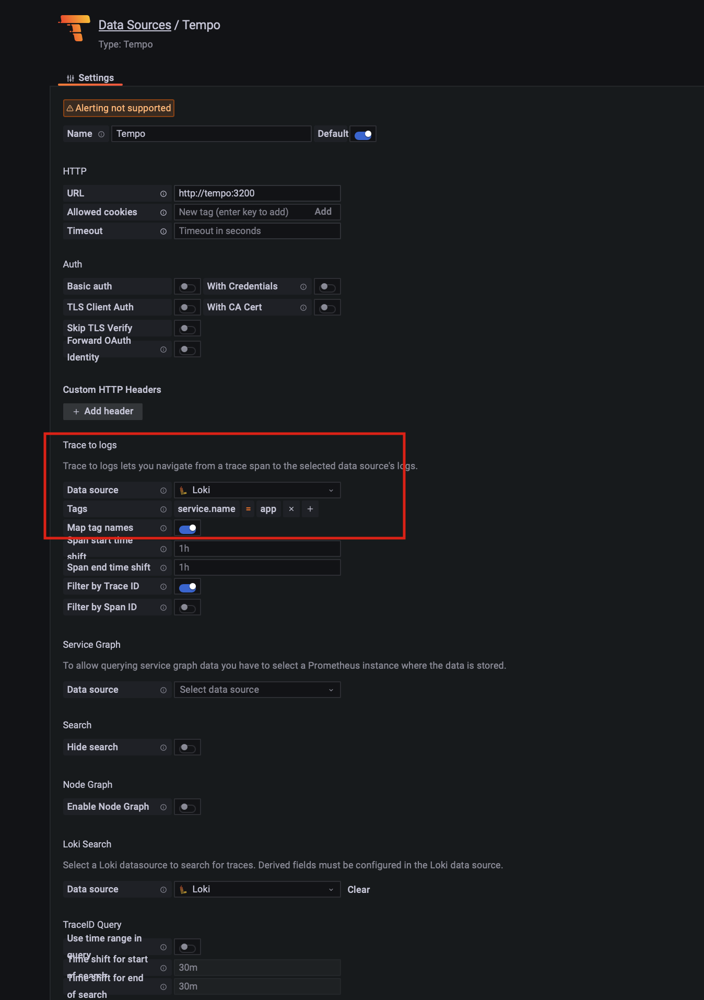

- **Loki**: defines a derived field that navigates from a log line to its trace.

  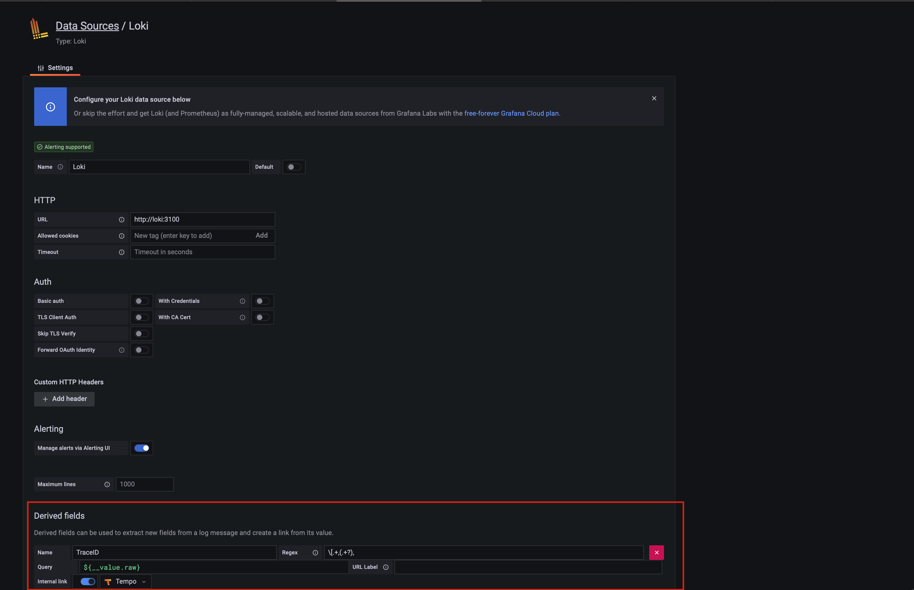
  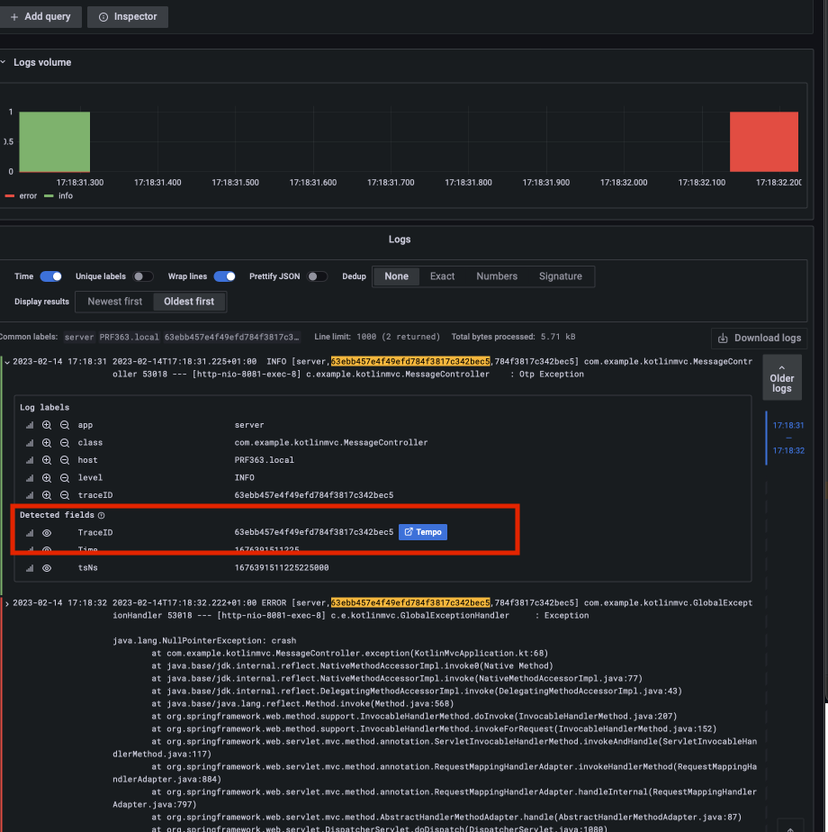

## How to run the example

1. Start the infrastructure from the project root:

   ```shell
   docker compose up -d
   ```

   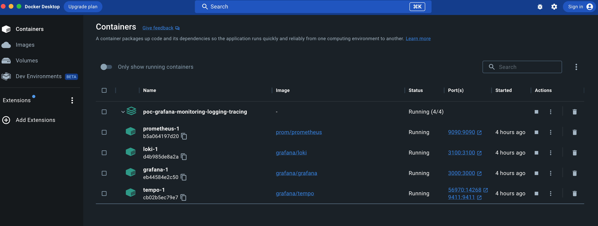

2. Run the Spring Boot application:

   ```shell
   ./gradlew bootRun
   ```

   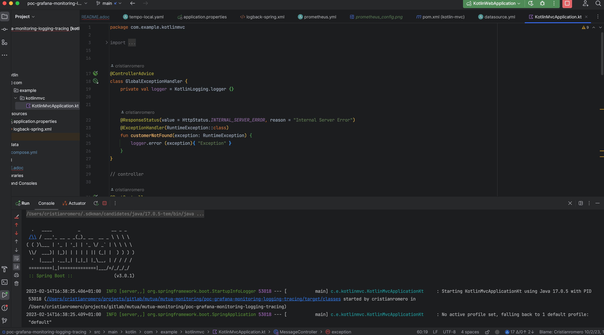

3. Generate some traffic by calling these endpoints a few times:

   - http://localhost:8080/message/ok
   - http://localhost:8080/message/ko
   - http://localhost:8080/message/exception

   ```shell
   for i in $(seq 1 20); do
     curl -s localhost:8080/message/ok; curl -s localhost:8080/message/ko; curl -s localhost:8080/message/exception
   done
   ```

4. Open Grafana at http://localhost:3000 and go to the *Logs, Traces, Metrics* dashboard:

   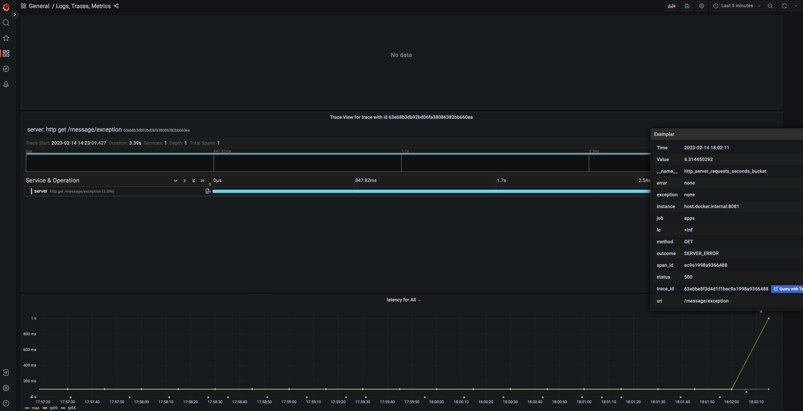
   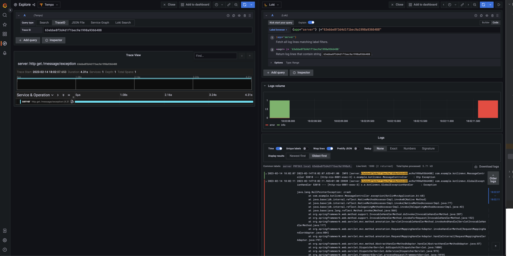

## Build and test

```shell
./gradlew build
```

The test suite boots the full application context. Loki isn't running during tests, so the Loki appender logs
connection-refused warnings; they don't fail the build.

## Continuous integration and dependency updates

- **GitHub Actions** (`.github/workflows/gradle.yml`) builds and tests the project on Temurin JDK 25 for every push and
  pull request to `main`, uploads test reports when the build fails, and submits the Gradle dependency graph so
  Dependabot alerts cover every dependency.
- **Dependabot** (`.github/dependabot.yml`) checks Gradle dependencies and GitHub Actions daily. Related updates are
  grouped (Kotlin, Spring Boot, observability, GitHub Actions, other minor/patch bumps) so that, for example, the Kotlin
  `jvm` and `plugin.spring` plugins always move together. Spring Boot major upgrades are ignored because they need a
  manual migration.

## Spring Boot observability

What is observability? It is "how well you can understand the internals of your system by examining its outputs".
The interconnection between metrics, logging and distributed tracing lets you reason about the state of your system
when you debug exceptions and latency in your applications.

To add observation features to the application, `spring-boot-starter-actuator` is a must (it adds Micrometer to the
classpath). `spring-boot-starter-aspectj` enables the `@Observed` annotation used in `MessageController`.

- **Metrics**: for Micrometer metrics with Prometheus, add `io.micrometer:micrometer-registry-prometheus`.
- **Tracing**: for trace context propagation with Micrometer Tracing you need a tracer bridge (the library that handles
  the span lifecycle). This project uses Zipkin Brave via `io.micrometer:micrometer-tracing-bridge-brave`. Since
  Spring Boot 4 the tracing auto-configuration lives in its own modules, so the project also adds
  `spring-boot-micrometer-tracing-brave` and `spring-boot-starter-zipkin`. To visualize latency, the finished spans
  are sent in Zipkin format (`io.zipkin.reporter2:zipkin-reporter-brave`) to Tempo.
- **Logs**: with Micrometer Tracing on the classpath, logs are automatically correlated (they contain the trace
  identifier). They are shipped to Grafana Loki with `com.github.loki4j:loki-logback-appender`.
